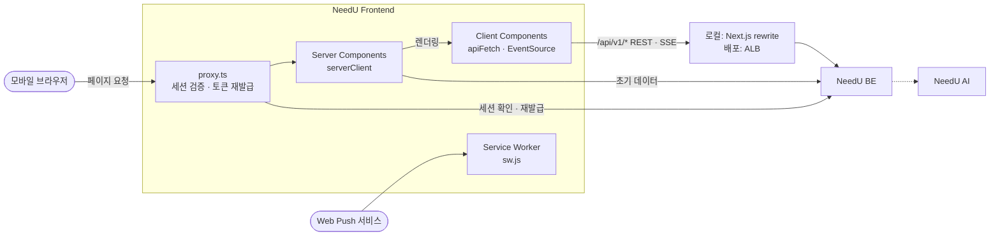
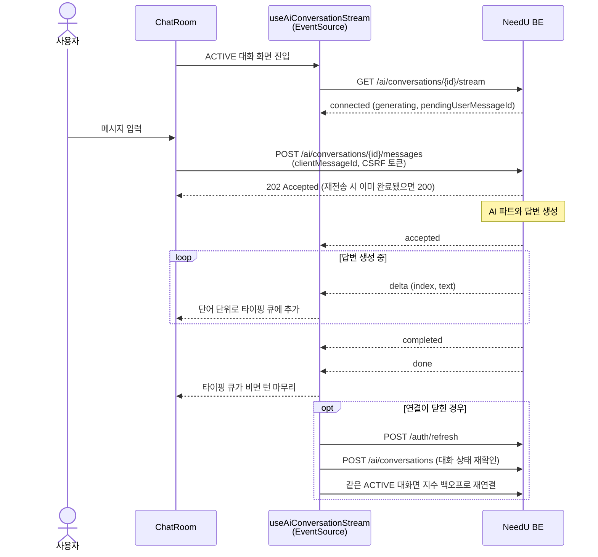
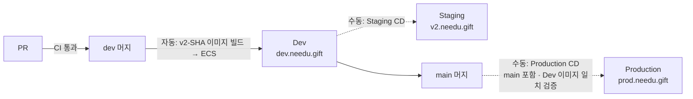

<!-- prettier-ignore-start -->
<!-- COMMON:START -->
<div align="center">

<br>

<h1>
  NeedU
  
</h1>

<h3>대화 몇 마디로 알아내는<br>나와 친구의 진짜 니즈</h3>

<p>
  <sub>AI 취향 분석&nbsp;&nbsp;·&nbsp;&nbsp;맞춤 상품 추천&nbsp;&nbsp;·&nbsp;&nbsp;친구 선물 추천&nbsp;&nbsp;·&nbsp;&nbsp;익명 채팅</sub>
</p>

<br>

<a href="https://needu.gift"></a>
&nbsp;
<a href="https://github.com/100-hours-a-week/KTB4-4th-wiki"></a>

<br>

</div>

## 서비스 소개

<p align="center">
  <sub><b>WHY NEEDU</b></sub>
</p>

<h3 align="center">
  내가 무엇을 좋아하는지,<br>
  친구가 무엇을 원하는지 모를 때
</h3>

<p align="center">
  NeedU는 AI와 나누는 짧은 대화에서 <b>나도 몰랐던 취향과 관심사</b>를 발견하고,<br>
  그 취향에 꼭 맞는 <b>나를 위한 상품</b>과 <b>친구를 위한 선물</b>을 찾아 줍니다.
</p>

<p align="center">
  <sub>취향을 말로 설명하기 어려운 사람도, 선물 앞에서 막막한 사람도 대화 몇 마디면 충분합니다.</sub>
</p>

<br>

<div align="center">
<table>
  <tr>
    <td align="center" width="180"><kbd>01</kbd><br><br><b>AI 취향 대화</b><br><sub>몰랐던 내 취향을<br>대화로 발견해요</sub></td>
    <td align="center" width="180"><kbd>02</kbd><br><br><b>맞춤 상품 추천</b><br><sub>내 취향에 맞는<br>상품만 골라요</sub></td>
    <td align="center" width="180"><kbd>03</kbd><br><br><b>친구 선물 추천</b><br><sub>친구 취향으로<br>선물을 찾아요</sub></td>
    <td align="center" width="180"><kbd>04</kbd><br><br><b>익명 채팅</b><br><sub>정체를 숨기고<br>슬쩍 물어봐요</sub></td>
    <td align="center" width="180"><kbd>05</kbd><br><br><b>알림</b><br><sub>생일·콕 찌르기를<br>놓치지 않아요</sub></td>
  </tr>
</table>
</div>

<details>
<summary><b>기능 자세히 보기</b></summary>
<br>
<div align="center">

| 기능 | 설명 |
| :---: | :---: |
| **AI 취향 대화** | AI와 편하게 이야기하면 답변이 실시간으로 이어지고,<br>대화가 끝나면 분석 결과를 확인하고 직접 다듬을 수 있습니다. |
| **맞춤 상품 추천** | 확정한 취향을 바탕으로 상품을 추천합니다.<br>가격과 카테고리로 원하는 상품만 골라 볼 수 있습니다. |
| **친구 선물 추천** | NeedU에 가입한 카카오 친구의 취향 요약을 보고,<br>그 친구에게 어울리는 선물을 추천받습니다. |
| **익명 채팅** | 친구에게 직접 묻기 어려울 때, 정체를 숨긴 채<br>대화하며 원하는 선물을 자연스럽게 물어봅니다. |
| **알림** | 친구의 생일, 친구 가입, 콕 찌르기, 구매 확인 소식을<br>앱 알림과 웹 푸시로 받습니다. |

</div>
</details>

### 팀 · 저장소

<div align="center">
<table>
  <tr>
    <th width="200">BE</th>
    <th width="200">AI</th>
    <th width="200">FE</th>
    <th width="200">CLOUD</th>
  </tr>
  <tr>
    <td align="center"><a href="https://github.com/jynoh00"></a> <a href="https://github.com/FinnPing1741"></a><br><sub><a href="https://github.com/jynoh00">jynoh00</a> · <a href="https://github.com/FinnPing1741">FinnPing1741</a></sub></td>
    <td align="center"><a href="https://github.com/seoddhh"></a><br><sub><a href="https://github.com/seoddhh">seoddhh</a></sub></td>
    <td align="center"><a href="https://github.com/juiuj"></a><br><sub><a href="https://github.com/juiuj">juiuj</a></sub></td>
    <td align="center"><a href="https://github.com/sodam2z"></a> <a href="https://github.com/hyo-lin"></a><br><sub><a href="https://github.com/sodam2z">sodam2z</a> · <a href="https://github.com/hyo-lin">hyo-lin</a></sub></td>
  </tr>
  <tr>
    <td align="center">비즈니스 로직 · API</td>
    <td align="center">대화 · 취향 분석 · 추천</td>
    <td align="center">화면 · 클라이언트 상태</td>
    <td align="center">인프라 · 배포 · 관측성</td>
  </tr>
  <tr>
    <td align="center"><a href="https://github.com/100-hours-a-week/KTB4-4th-BE"><code>KTB4-4th-BE</code></a></td>
    <td align="center"><a href="https://github.com/100-hours-a-week/KTB4-4th-AI"><code>KTB4-4th-AI</code></a></td>
    <td align="center"><a href="https://github.com/100-hours-a-week/KTB4-4th-FE"><code>KTB4-4th-FE</code></a></td>
    <td align="center"><a href="https://github.com/100-hours-a-week/KTB4-4th-CLOUD"><code>KTB4-4th-CLOUD</code></a></td>
  </tr>
</table>
</div>

<!-- COMMON:END -->
<!-- prettier-ignore-end -->

<br/>

---

<!-- PART:START -->

<div align="center">

<h1>NeedU Frontend</h1>

<p>카카오 로그인, AI 취향 대화, 맞춤 상품·선물 추천, 친구, 알림 화면을 제공하는 Next.js 모바일 웹</p>

[](https://github.com/100-hours-a-week/KTB4-4th-FE/actions/workflows/frontend-ci.yml)


</div>

<br/>

## 책임 범위

**담당**

- 모바일 웹 화면 구성과 화면 간 이동 (Next.js App Router)
- 보호 페이지 접근 시 로그인 세션 검증과 액세스 토큰 재발급 (`src/proxy.ts`)
- AI 대화·알림 SSE 스트림 수신과 끊김 복구, 응답의 실시간 표시
- 웹 푸시 구독과 서비스 워커 등록 (`public/sw.js`)
- 대화·알림·친구 상세 등 클라이언트 상태 관리 (React Context)
- 브라우저·서버·Edge 오류 수집 (Sentry)과 프론트엔드 컨테이너 이미지 빌드

**비담당**

- API 제공, 인증 토큰 발급, 비즈니스 로직 → [BE](https://github.com/100-hours-a-week/KTB4-4th-BE)
- AI 응답 생성, 취향 분석, 추천 상품 산정 → [AI](https://github.com/100-hours-a-week/KTB4-4th-AI)
- ALB·ECS 등 인프라 구성과 도메인 관리 → [CLOUD](https://github.com/100-hours-a-week/KTB4-4th-CLOUD)

## 기술 스택

| 분류         | 기술                                              | 사용 목적                                                                     |
| ------------ | ------------------------------------------------- | ----------------------------------------------------------------------------- |
| Language     | TypeScript 5.9 (strict)                           | API 응답과 SSE 이벤트 타입을 컴파일 시점에 검증                               |
| Framework    | Next.js 16.3 (App Router)                         | 라우트 단위 화면 구성, `proxy.ts` 기반 보호 페이지 인증, 로컬 개발용 API 중계 |
| UI           | React 19.2                                        | 화면 컴포넌트와 Context 기반 클라이언트 상태 관리                             |
| Styling      | Tailwind CSS 4.3 · CSS Modules                    | `globals.css` 디자인 토큰 기반 스타일, 컴포넌트 단위 스타일 분리              |
| Realtime     | SSE · Web Push (Service Worker)                   | AI 응답 스트리밍과 실시간 알림, 앱을 닫았을 때의 푸시 알림                    |
| Monitoring   | Sentry (`@sentry/nextjs` 11.1) · Google Analytics | 오류 수집과 소스맵 업로드, 페이지 이용 분석                                   |
| Code Quality | ESLint 9 · Prettier 3                             | 코드 규칙과 포맷 검사 (CI에서 강제)                                           |
| Release      | semantic-release 25                               | `main` 반영 시 커밋 메시지 기준으로 태그와 GitHub Release 자동 생성           |
| Deploy       | Docker (Node 24.19 Alpine) · AWS ECR · ECS        | 컨테이너 이미지 빌드와 환경별 배포                                            |

## 아키텍처



**설계 원칙**

- **인증은 페이지 진입 전에 서버에서** — `proxy.ts`가 보호 페이지 요청마다 세션을 확인하고, 만료됐으면 토큰을 재발급하며, 온보딩 전이면 `/onboarding`으로 보냅니다. 화면이 그려진 뒤 로그인 페이지로 튕기는 일을 막기 위함입니다.
- **브라우저는 같은 출처의 `/api/v1/*`만 호출** — 로컬에서는 Next.js rewrite가, 배포 환경에서는 ALB가 BE로 전달합니다. 쿠키 기반 인증과 CSRF 토큰을 CORS 설정 없이 그대로 사용하기 위함입니다.
- **스트림 끊김은 서버 상태로 복구** — `EventSource`는 HTTP 상태 코드를 알 수 없으므로, 연결이 닫히면 토큰 재발급 후 대화 시작 API로 대화 상태를 다시 확인하고 1초부터 최대 30초까지 지수 백오프로 재연결합니다.
- **하나의 이미지로 모든 환경 배포** — 환경마다 다른 값은 런타임 환경 변수(`BACKEND_API_BASE_URL`, `SENTRY_ENVIRONMENT`)와 접속 도메인으로 구분합니다. Dev에서 검증한 이미지를 다시 빌드하지 않고 Production에 배포하기 위함입니다.

### AI 취향 대화 스트리밍 흐름



- `clientMessageId`로 같은 메시지의 재전송을 구분하므로, 네트워크 오류로 다시 보내도 답변이 중복 생성되지 않습니다.
- 사용자가 동작 줄이기(`prefers-reduced-motion`)를 켰다면 타이핑 효과 없이 받은 내용을 바로 표시합니다.
- 서버가 `error` 이벤트에 `restartRequired`를 보내면 대화를 만료 처리하고 새 대화 시작을 안내합니다.

## 시작하기

**필요 도구** — Node.js 24.10 이상 · npm · 접속할 BE API 서버 (로컬 BE 또는 Dev)

```bash
git clone https://github.com/100-hours-a-week/KTB4-4th-FE.git
cd KTB4-4th-FE

cp .env.example .env.local
npm ci
npm run dev
```

`http://localhost:3000`이 열리면 준비 완료입니다. 포트를 바꾸려면 `PORT=3100 npm run dev`처럼 실행합니다.

<details>
<summary><b>환경 변수 목록</b></summary>

<br/>

전체 목록은 [`.env.example`](./.env.example)에 있습니다. 실제 키는 README와 `.env.example`에 넣지 않습니다.

`NEXT_PUBLIC_` 접두사가 있는 값은 브라우저 번들에 포함되어 빌드 후 바꿀 수 없습니다. 로컬 개발에는 `BACKEND_API_BASE_URL`만 있으면 됩니다.

| 변수                        | 필수 | 주입 시점 | 설명                                                  |
| --------------------------- | :--: | :-------: | ----------------------------------------------------- |
| `BACKEND_API_BASE_URL`      |  ✓   |   실행    | Next.js 서버가 호출할 BE API 기본 주소. 환경별로 다름 |
| `SENTRY_ENVIRONMENT`        |      |   실행    | 서버와 Edge의 Sentry 환경 이름. 환경별로 다름         |
| `SENTRY_DSN`                |      |   실행    | 서버에서 공개 DSN 대신 사용할 선택 값                 |
| `NEXT_PUBLIC_SENTRY_DSN`    |      |   빌드    | 브라우저와 서버의 Sentry 이벤트 전송 주소             |
| `NEXT_PUBLIC_USE_MOCK_DATA` |      |   빌드    | 친구·추천 상품 목업 데이터 사용 여부                  |
| `SENTRY_ORG`                |      |   빌드    | Sentry 조직 slug                                      |
| `SENTRY_PROJECT`            |      |   빌드    | Sentry 프로젝트 slug                                  |
| `SENTRY_AUTH_TOKEN`         |      |   빌드    | 프로덕션 빌드의 소스맵 업로드 인증. **비밀값**        |
| `SENTRY_RELEASE`            |      |   빌드    | 오류와 소스맵을 연결할 릴리스 식별자                  |

**환경별 실행 값**

| 환경 | `BACKEND_API_BASE_URL`       | `SENTRY_ENVIRONMENT` |
| ---- | ---------------------------- | -------------------- |
| Dev  | `https://dev.needu.gift/api` | `development`        |
| Prod | `https://needu.gift/api`     | `production`         |

**도메인별 브라우저 Sentry 환경**

| 도메인            | 역할                    | Sentry environment |
| ----------------- | ----------------------- | ------------------ |
| `dev.needu.gift`  | V2 개발                 | `development`      |
| `v2.needu.gift`   | V2 Staging              | `staging`          |
| `prod.needu.gift` | V2 Production 사전 확인 | `production`       |
| `needu.gift`      | 최종 Production         | `production`       |

로컬 개발처럼 위 목록에 없는 도메인은 `development`로 처리합니다. 로컬에서 오류 수집만 확인할 때는 `NEXT_PUBLIC_SENTRY_DSN`만 있으면 됩니다. `NEXT_PUBLIC_USE_MOCK_DATA`는 로컬 성능 측정이 필요할 때만 `true`로 바꾸고, 공통 배포 이미지에서는 `false`를 유지합니다.

**API 요청 경로**

로컬 개발에서는 Next.js가 브라우저의 `/api/v1/*` 요청을 `BACKEND_API_BASE_URL`로 중계합니다. 배포 환경에서는 이 rewrite를 만들지 않으며, ALB Listener Rule이 `/api/v1/*` 요청을 Backend Target Group으로 전달합니다. 다만 `src/proxy.ts`와 서버 컴포넌트는 배포 환경에서도 BE API를 직접 호출하므로, 컨테이너 실행 시 `BACKEND_API_BASE_URL`을 반드시 주입해야 합니다.

**CI 빌드 변수**

GitHub Actions는 `/needu/common/frontend-build`에서 `NEXT_PUBLIC_SENTRY_DSN`, `SENTRY_ORG`, `SENTRY_PROJECT`, `SENTRY_AUTH_TOKEN`을 조회합니다. 인증 토큰은 Docker BuildKit secret으로 빌드 단계에만 전달되며 이미지 환경 변수나 레이어에 남지 않습니다. `SENTRY_RELEASE`에는 커밋 SHA가 자동으로 들어갑니다.

</details>

## 화면 구성

`/login`, `/error`를 뺀 모든 화면은 `proxy.ts`의 로그인 세션 검증을 거칩니다. `(main)` 그룹 화면은 공통 헤더와 하단 내비게이션을 함께 씁니다.

| 경로                    | 화면         | 내용                                                                  |
| ----------------------- | ------------ | --------------------------------------------------------------------- |
| `/login`                | 로그인       | 카카오 로그인 시작                                                    |
| `/onboarding`           | 온보딩       | 개인정보 동의와 첫 취향 입력                                          |
| `/`                     | 홈           | 취향 데이터가 있으면 맞춤 상품, 없으면 AI 대화 안내                   |
| `/ai`                   | AI 취향 대화 | SSE 스트리밍 채팅, 취향 분석 결과 확인                                |
| `/products`             | 상품 추천    | 내 맞춤 추천. `?targetType=FRIEND&targetUserId={id}`면 친구 선물 추천 |
| `/products/[productId]` | 상품 상세    | 추천 문맥에 맞는 상품 상세 정보                                       |
| `/friends`              | 친구 목록    | 카카오 친구 연결, 검색, 즐겨찾기, 콕 찌르기                           |
| `/friends/[friendId]`   | 친구 상세    | 친구 취향 요약, 선물 추천으로 이동                                    |
| `/mypage`               | 마이페이지   | 프로필과 AI 취향 분석 정보                                            |
| `/settings`             | 설정         | 알림·웹 푸시 설정, 약관 동의 내용, 회원 탈퇴                          |
| `/settings/preferences` | 취향 수정    | 저장된 취향 데이터 조회와 수정                                        |
| `/error`                | 오류         | 인증·서버 오류 안내                                                   |

## 디렉터리 구조

```text
KTB4-4th-FE
├── .github/              CI·배포 워크플로, README 에셋
├── public/               정적 아이콘·이미지, 웹 푸시 서비스 워커(sw.js)
├── src/
│   ├── app/              App Router 라우트, 레이아웃, 전역 스타일(globals.css)
│   ├── components/       화면별로 묶은 UI 컴포넌트
│   ├── contexts/         전역 클라이언트 상태 (React Context)
│   ├── hooks/            SSE 스트림, 웹 푸시 등 재사용 훅
│   ├── lib/              API 클라이언트, 인증 세션, 공통 유틸
│   ├── mocks/            성능 측정용 목업 데이터
│   ├── types/            도메인 타입
│   ├── proxy.ts          보호 페이지 인증 프록시
│   └── instrumentation*.ts  Sentry 초기화
├── sentry.*.config.ts    서버·Edge 런타임 Sentry 설정
├── Dockerfile            배포 이미지 빌드
└── next.config.ts        보안 헤더, 로컬 API 중계, Sentry 빌드 설정
```

## 검증

```bash
npm run format:check   # Prettier 포맷 검사
npx next typegen       # 라우트 타입 생성 (type-check 전에 필요)
npm run type-check     # TypeScript 타입 검사
npm run lint           # ESLint 검사
npm run build          # 프로덕션 빌드
```

| 종류         | 대상                                                           |
| ------------ | -------------------------------------------------------------- |
| Format       | 저장소 전체 파일의 Prettier 규칙 준수 (`.prettierignore` 제외) |
| Type         | 라우트 타입을 포함한 TypeScript strict 타입 검사               |
| Lint         | ESLint 규칙과 사용하지 않는 import 검사                        |
| Build        | Next.js 프로덕션 빌드 성공 여부                                |
| Docker Build | `dev` 대상 PR에서 배포 이미지 빌드 성공 여부                   |

PR은 [`Frontend CI`](./.github/workflows/frontend-ci.yml)의 Format·Type·Lint·Build 검사를 모두 통과해야 하며, `dev` 대상 PR은 Docker 빌드 검사도 통과해야 합니다. 자동화 테스트 코드는 아직 없습니다.

## 배포



- **Dev** — `dev`에 push되면 `v2-{SHA}` 이미지를 ECR에 올리고 Dev ECS 서비스에 자동 배포합니다. ECS 서비스가 안정화되고 요청한 이미지가 반영됐는지까지 확인합니다.
- **Staging** — [`Frontend V2 Staging CD`](./.github/workflows/staging-deploy.yml)를 이미지 SHA와 함께 수동 실행합니다.
- **Production** — [`Frontend V2 Production CD`](./.github/workflows/prod-deploy.yml)를 이미지 SHA와 함께 수동 실행합니다. 해당 SHA가 `main`에 포함됐는지, Dev 배포가 성공했는지, Dev에서 실행 중인 이미지와 같은지 확인한 뒤 배포하고 `prod-YYYYMMDD-{실행 번호}` 태그를 남깁니다.
- **롤백** — 이전 `prod-*` 태그가 가리키는 SHA로 Production CD를 다시 실행합니다. ECR에 남아 있는 이미지를 그대로 다시 배포하므로 새로 빌드하지 않습니다.
- **모니터링** — Sentry로 브라우저·서버·Edge 오류를 환경별로 수집하고, 소스맵은 빌드할 때 업로드한 뒤 이미지에서 지웁니다.

### 릴리스

[`release.config.mjs`](./release.config.mjs)에 따라 semantic-release가 `main` 브랜치의 커밋 메시지를 분석해 `v{버전}` 태그와 GitHub Release를 만듭니다.

| 커밋               | 릴리스        |
| ------------------ | ------------- |
| `BREAKING CHANGE`  | major         |
| `feat`             | minor         |
| `fix`, `perf`      | patch         |
| `chore`, `docs` 등 | 생성하지 않음 |

로컬에서는 다음 명령으로 게시 없이 설정을 확인할 수 있습니다.

```bash
npm run release:dry-run
```

## 기술적 결정

> [!WARNING]
> **추후 작성 예정입니다.** 결정마다 "문제 → 선택 → 결과" 순서로, 측정 수치가 있으면 전후 비교 표와 함께 추가합니다.

## 협업 규칙

| 항목   | 규칙                                                                                                                                                        |
| ------ | ----------------------------------------------------------------------------------------------------------------------------------------------------------- |
| 브랜치 | `type/#이슈번호-작업-요약` (예: `feat/#90-login-page`). 최신 `dev`에서 만들고, 브랜치 하나에는 이슈 하나만 다룹니다.                                        |
| 커밋   | `type: 작업 제목 (#이슈번호)` (예: `fix: 로그인 실패 처리 수정 (#91)`). 커밋 하나에는 목적 하나만 담습니다.                                                 |
| PR     | `dev`를 대상으로 열고 [PR 템플릿](./pull_request_template.md)의 구현 배경·작업 사항·추가 논의·이슈를 채웁니다. `Frontend CI`를 통과해야 머지할 수 있습니다. |

사용 가능한 type은 `feat` `fix` `perf` `refactor` `chore` `docs` `style` `test` `ci`입니다. 자세한 기준은 [`AGENTS.md`](./AGENTS.md)에 있습니다.

## 문제 해결

> [!WARNING]
> **추후 작성 예정입니다.** 처음 세팅하는 팀원이 실제로 겪은 문제를 "증상(에러 메시지) → 원인 → 해결 방법" 순서로 추가합니다.

## 문서 · 문의

- [작업 규칙 (AGENTS.md)](./AGENTS.md) · [팀 위키](https://github.com/100-hours-a-week/KTB4-4th-wiki)
- 이슈: [GitHub Issues](https://github.com/100-hours-a-week/KTB4-4th-FE/issues) · 팀 채널: [Discord](https://discord.gg/ypV2sNM7r)

<!-- PART:END -->
